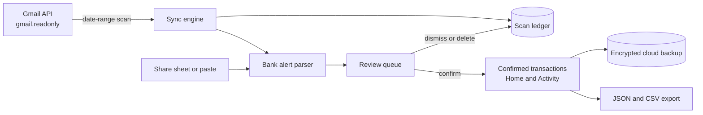
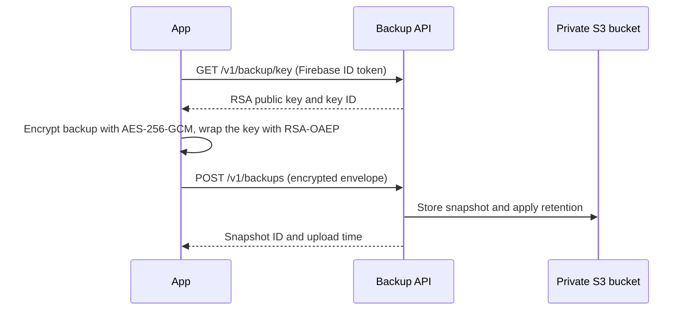

# Pocketlog

[](https://github.com/zhafranrifand/Collabera-Test/actions/workflows/android-apk.yml)

**Pocketlog turns the transaction alerts your bank already emails you into a private, reviewable spending log.** It reads supported alerts from Gmail (read-only), parses them on your phone, and holds every new transaction in a Review queue until you confirm it. Nothing counts toward your totals until you say so.

Version **1.1.0** · Android (Kotlin, Jetpack Compose) · Min SDK 26 · Target SDK 35 · Package `com.expensemail.app`

## Table of contents

- [Features](#features)
- [How it works](#how-it-works)
- [Supported banks and alert types](#supported-banks-and-alert-types)
- [Using the app](#using-the-app)
- [Privacy and security](#privacy-and-security)
- [Getting started](#getting-started)
- [Gmail sync in depth](#gmail-sync-in-depth)
- [Backup and restore](#backup-and-restore)
- [Architecture](#architecture)
- [Backup API](#backup-api)
- [Development, testing, and CI](#development-testing-and-ci)
- [Troubleshooting](#troubleshooting)
- [Known limitations](#known-limitations)
- [Contributing](#contributing)

## Features

**Capture**
- Scan Gmail over a date range you choose, restricted to supported bank sender addresses
- Share a single alert from Gmail to Pocketlog, or paste alert text manually
- Long scans continue in the background with a cancelable notification and can be resumed
- Skipped-alert list: inspect, recheck, manually add, or dismiss emails the parser did not recognize

**Review and organize**
- Review queue with edit, confirm, bulk confirm, and delete
- Merchant-based category suggestions and bank detection from the sender
- Transfers are labeled separately and excluded from spending totals unless you change the type

**Understand your spending**
- Monthly spend card with a comparison against the same days of the previous month
- Six-month trend, top merchants for the month, and recent activity
- Activity history with All, This month, Custom, and Monthly views, shown 25 items per page

**Keep your data safe**
- Versioned JSON backup and restore with a merge preview
- CSV export for spreadsheets
- Optional encrypted cloud backup for allow-listed tester accounts

## How it works



1. **Find** alerts either by scanning Gmail or by sharing one email to the app.
2. **Parse** them on the device into a merchant, amount, date, bank, and type (expense or transfer).
3. **Review** each transaction. Confirming it adds it to your totals.
4. **Remember** every handled email in a per-account ledger so the same alert is never imported twice and dismissed emails never come back.

## Supported banks and alert types

| Bank | Sender address the app accepts |
| --- | --- |
| BCA | `bca@bca.co.id` |
| Livin' by Mandiri | `noreply.livin@bankmandiri.co.id` |
| Bank Jago | `noreply@jago.com` |
| UOB | `noreply_UOB@uob.co.id` |

How parsing works:

- Only these sender addresses are accepted, and each bank must also match its own expected fields (for example, BCA alerts need a successful status, UOB alerts need a `Jumlah` field).
- The parser reads labeled amount, date, and recipient fields and understands Indonesian thousands and decimal separators.
- BCA transfer-style alerts (bank transfers, virtual account payments, cardless cash withdrawals) are recorded as **Transfer** instead of **Expense**.
- Most templates without a transaction date are skipped. One Jago card/fee format uses Gmail's received time as an estimated date.
- A sender domain is only a hint, not proof an email is genuine. Review every imported transaction.

Categories are suggested from the merchant name: Transport, Groceries, Food & drink, Shopping, Subscriptions, Transfer, or Other. You can change any category in Edit.

## Using the app

| Screen | What you do there |
| --- | --- |
| **Home** | See this month's spend, trend, top merchants, and recent transactions. **Import bank emails** starts a Gmail scan. |
| **Review** | Confirm, edit, or delete pending transactions. Paste alert text manually. Open the skipped-alert list. |
| **Activity** | Browse confirmed transactions by date range and see totals (transfers excluded). |
| **Settings** | Connect or disconnect Gmail, pick the scan date range, run or resume a scan, recheck skipped emails, and manage backups. |

**Typical flow:** open Settings or Home, choose a date range, scan Gmail, then confirm what lands in Review. The default range is the last 90 days.

**Share flow:** open a bank alert in Gmail and choose **Share → Pocketlog**. If Gmail only offers a link, copy the alert text and paste it in Review. Only the text you share is parsed, and the original email is not saved. If the sender is missing, enter the sender address or domain in the optional field.

## Privacy and security

| Data | Where it goes |
| --- | --- |
| Email bodies | Read and parsed on the device. Not saved and not uploaded. |
| Gmail OAuth tokens | Held in memory for the session. Not saved and not uploaded. |
| Transactions and scan history | Stored on the device in app-private storage. |
| Cloud backup (optional) | Encrypted on the device, then uploaded to the Pocketlog backup service. |

**Cloud backup is encryption at rest with server-assisted restore. It is not end-to-end encrypted.** On restore the service unwraps the backup's content key with its private key and returns it over TLS, so whoever operates the service can decrypt backups. Backups contain transaction records (merchant, amount, date, category, bank) and, for Gmail-imported items, the sender, subject, and message ID. They do not contain email bodies or tokens.

**Permissions requested**

| Permission | Why |
| --- | --- |
| `INTERNET` | Gmail API and cloud backup |
| `FOREGROUND_SERVICE`, `FOREGROUND_SERVICE_DATA_SYNC` | Keep a user-started Gmail scan running in the background |
| `POST_NOTIFICATIONS` | Show scan progress and a cancel action (Android 13+) |

**Built-in safeguards**
- Gmail access uses the read-only `gmail.readonly` scope. Google's consent screen describes this as access to Gmail messages broadly, even though the app only queries supported bank senders in your chosen dates.
- Android auto-backup is disabled and cleartext network traffic is blocked.
- The Gmail access token is removed from the service intent as soon as it is read.
- CSV export neutralizes cells that start with `=`, `+`, `-`, or `@` to prevent spreadsheet formula injection.
- Disconnecting Gmail revokes Google's grant but keeps local scan history and imported transactions.
- Uninstalling the app deletes all local data. Export a backup first.

## Getting started

### Prerequisites

- JDK 17
- Android SDK platform 35 and Build Tools 35
- Android Studio (recommended). The repository includes the Gradle wrapper configuration (Gradle 8.9), so Android Studio downloads the right version on first sync. For command-line builds, install Gradle 8.9.

### Run the app

1. Clone the repository and open it in Android Studio.
2. Let Gradle sync, then run the `app` configuration on a device or emulator.

Without any Google setup you can use the Share flow and manual paste. Gmail sync and cloud backup need the configuration below.

### Configure Gmail sync

1. In a Google Cloud project, enable the **Gmail API**.
2. Configure the OAuth consent screen with the `gmail.readonly` scope. While the app is in Testing, add your Google account as a test user.
3. Create an **Android** OAuth client for package `com.expensemail.app` with the SHA-1 of the certificate that signed the installed build.
4. Register the Firebase beta certificate and your Android Studio debug certificate as separate clients. Keep older clients for existing installs.
5. Public distribution requires Google's verification for this restricted scope.

### Configure cloud backup (optional)

Cloud backup uses Firebase Authentication with Google sign-in and the Pocketlog backup API. You need a Firebase project with Google sign-in enabled, the client configuration in `app/google-services.json`, and a running backup API that allow-lists your account. See [`backup-api/README.md`](backup-api/README.md) for the service setup.

Never commit keystores, passwords, or service-account files. `.gitignore` already excludes `*.jks`, `*.keystore`, and `*service-account*.json`.

## Gmail sync in depth

**What is searched.** The query combines your date range with the four supported sender addresses. Nothing else in your mailbox is requested.

**How a scan runs.** Scans are bounded and resumable. Each batch lists up to 50 messages per page, walks at most 5 pages, and inspects at most 50 messages before saving progress. Every inspected message is committed to the ledger before the page cursor advances, so an interrupted scan loses nothing and picks up where it stopped.

**Scan modes**

| Mode | What it does |
| --- | --- |
| Normal | Starts a scan of the selected date range |
| Continue | Resumes a saved cursor for the same account and date range |
| Recheck skipped | Re-evaluates emails that were previously skipped, for example after a parser improvement |

**Ledger states.** Every handled message is recorded per Google account:

| State | Meaning |
| --- | --- |
| `IMPORTED` | Became a transaction. Never imported again. |
| `SKIPPED` | Matched a supported sender but no transaction was found. Can be rechecked, manually added, or dismissed. |
| `DISMISSED` | You deleted the transaction or dismissed the email. It stays dismissed in future scans and restores. |
| `LEGACY_UNKNOWN` | Handled before the per-account ledger existed. Treated as recheckable. |

**Background behavior.** A scan runs in a foreground service with a cancel action. Android may still stop it after a force-stop, a shutdown, or a system time limit; completed batches are already saved, so reopen the app and continue. If notification permission is denied, the scan still runs but the notification may be hidden.

## Backup and restore

| Option | What it contains | Restorable |
| --- | --- | --- |
| **JSON backup** | Transactions and Gmail scan history (ledger and cursors) | Yes |
| **CSV export** | Transactions only (id, merchant, amount, date, category, source, status, bank, type, Gmail fields) | No, for spreadsheets only |
| **Cloud backup** | Same as JSON backup, encrypted | Yes |

**Restore never overwrites your current data.** It shows a preview, then merges:
- Transactions already on the device win conflicts.
- Duplicate transactions and Gmail messages are skipped.
- Dismissed emails stay dismissed and are not brought back.
- Missing scan history and cursors are added.

The JSON file declares the format `pocketlog-backup` and a version. Files from a different format or a newer version are rejected rather than partly imported, and files over 25 MB are refused.

**Cloud backup flow**



Retention keeps the newest snapshot for each of the seven most recent days and for the next four older weeks. Restore currently loads the latest snapshot and shows the same merge preview.

Export a JSON backup before replacing an installation signed with a different key, and before uninstalling.

## Architecture

**Project layout**

```
app/src/main/java/com/expensemail/app/
  MainActivity.kt           Entry point; handles the Share intent
  ExpenseMailApp.kt         Top-level app state and flows
  Theme.kt                  Color tokens and shared constants
  Expense.kt                Transaction model
  Formatting.kt             Currency, date, and label helpers
  ExpenseStorage.kt         SharedPreferences load and save for transactions
  HomeScreen.kt             Dashboard
  ReviewScreen.kt           Review queue and manual import
  ActivityScreen.kt         Confirmed transactions and filters
  SkippedScreens.kt         Skipped-alert list and detail dialog
  SettingsScreen.kt         Gmail, backup, and cloud backup settings
  Components.kt             Shared UI pieces
  Dialogs.kt                Edit and restore dialogs
  BankAlertParser.kt        Bank email parsing
  GmailInboxReader.kt       Gmail API client
  GmailSyncEngine.kt        Bounded, resumable scan logic
  GmailSyncForegroundService.kt  Background scan service
  GmailSyncRuntime.kt       Shared scan status for the UI
  SyncLedger.kt             Per-account message ledger and scan cursors
  AndroidGmailSyncStore.kt  Persistence for synced data
  ExpenseBackup.kt          JSON backup codec, merge logic, CSV export
  CloudBackupEnvelope.kt    Encrypted envelope format
  CloudBackupClient.kt      HTTPS client for the backup API
app/src/test/               JVM unit tests
backup-api/                 Node 22 service for encrypted snapshots
.github/workflows/          CI and beta distribution
```

**Storage.** Transactions are stored as JSON in app-private SharedPreferences, and Gmail scan state is kept in a per-account ledger beside them. Dates are stored as display strings (for example `11 Oct 2026`).

**Transaction model.** Each record has an ID, merchant, amount in rupiah (whole numbers), date, category, source, confirmed flag, bank, and record type (Expense or Transfer). Gmail-imported records also keep the account, message ID, sender, subject, and received time so duplicates can be detected.

## Backup API

A small TypeScript service (Node 22, Hono) that stores encrypted snapshots in a private S3-compatible bucket.

| Method and path | Purpose |
| --- | --- |
| `GET /health` | Process health only |
| `GET /v1/backup/key` | Active public key and crypto parameters |
| `POST /v1/backups` | Upload an encrypted snapshot |
| `GET /v1/backups` | List snapshots, newest first |
| `GET /v1/backups/{id}` | Fetch a snapshot and its content key for restore |
| `DELETE /v1/backups/{id}` | Delete a snapshot |

Every `/v1` request requires a verified Firebase ID token from an allow-listed email. Requests are rate limited, bodies are capped at 15 MiB, responses use `no-store`, and the service does not log requests or payloads. Full details, environment variables, key rotation, and the envelope contract are in [`backup-api/README.md`](backup-api/README.md).

## Development, testing, and CI

**Android**

```sh
gradle :app:testDebugUnitTest :app:lint   # unit tests and lint (Gradle 8.9)
gradle :app:assembleDebug                 # debug APK
```

Unit tests cover the parser, sync engine, ledger, JSON codecs, backup merge, CSV export, cloud envelope encryption, and timeline logic.

**Backup API**

```sh
cd backup-api
npm install
npm test
npm run typecheck
npm start
```

Tests use in-memory storage and generated keys. They never contact Firebase, S3, or any external account.

**Continuous integration.** The GitHub Actions workflow (`android-apk.yml`) runs the backup API tests and typecheck, Android unit tests, and lint on every push and pull request. Branch builds publish a debug APK artifact. Only `main`, with the repository variable `FIREBASE_BETA_ENABLED` set to `true`, builds a signed release and distributes it to the Firebase App Distribution group `mvp-testers`. Each run uses a fresh, increasing version code.

**Beta distribution setup.** Set the repository variable `FIREBASE_APP_ID` and these Actions secrets: `FIREBASE_SERVICE_ACCOUNT_JSON`, `BETA_KEYSTORE_BASE64`, `BETA_STORE_PASSWORD`, `BETA_KEY_ALIAS`, and `BETA_KEY_PASSWORD`. Use a dedicated service account with the Firebase App Distribution Admin role. Keep the original keystore and passwords backed up securely, because changing the signing certificate prevents in-place updates.

**Build environment variables** (read by `app/build.gradle.kts`): `CI_VERSION_CODE`, `CI_VERSION_NAME`, `BETA_KEYSTORE_PATH`, `BETA_STORE_PASSWORD`, `BETA_KEY_ALIAS`, `BETA_KEY_PASSWORD`.

## Troubleshooting

| Problem | What to check |
| --- | --- |
| Gmail sign-in fails or shows an error | The Android OAuth client must match package `com.expensemail.app` and the SHA-1 of the certificate that signed the installed build. Debug and beta builds need separate clients. |
| Google says the app is blocked | While the consent screen is in Testing, your account must be listed as a test user. |
| "Gmail access expired" | Reconnect Gmail in Settings and run the scan again. |
| A scan stopped partway | Reopen the app and choose Continue. Completed batches are saved. |
| No progress notification | Notification permission may be off. The scan still runs. |
| An alert was skipped | Open Review → skipped list. You can recheck it, add it manually, or dismiss it. |
| A deleted transaction does not reappear after a scan | By design. Deleting dismisses the email. |
| A new APK will not install over the old one | The signing key differs. Export a JSON backup, uninstall, install the new build, and restore. |
| Cloud sign-in is rejected | Google sign-in must be enabled in the Firebase project, and your email must be on the backup API allow-list. |

## Known limitations

- Data lives in a single JSON string in SharedPreferences, with dates stored as display strings. A database migration is planned.
- Amounts are Indonesian rupiah only.
- Cloud backup is limited to allow-listed tester accounts that share one vault, it is not end-to-end encrypted, and restore uses the latest snapshot only.
- Bank email templates change. Unrecognized formats land in the skipped list instead of being guessed.
- Public Gmail distribution requires Google's restricted-scope verification.

## Contributing

1. Create a branch and keep changes focused.
2. Run `gradle :app:testDebugUnitTest :app:lint` and, for backup API changes, `npm test` and `npm run typecheck` in `backup-api/`.
3. When adding or changing a bank template, add a parser test with a sanitized sample alert (no real names, account numbers, or balances).
4. Never commit secrets, keystores, or real transaction data.
